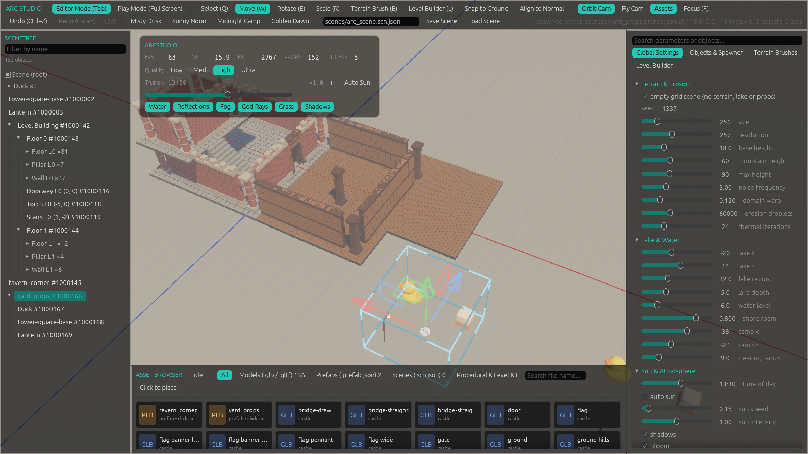
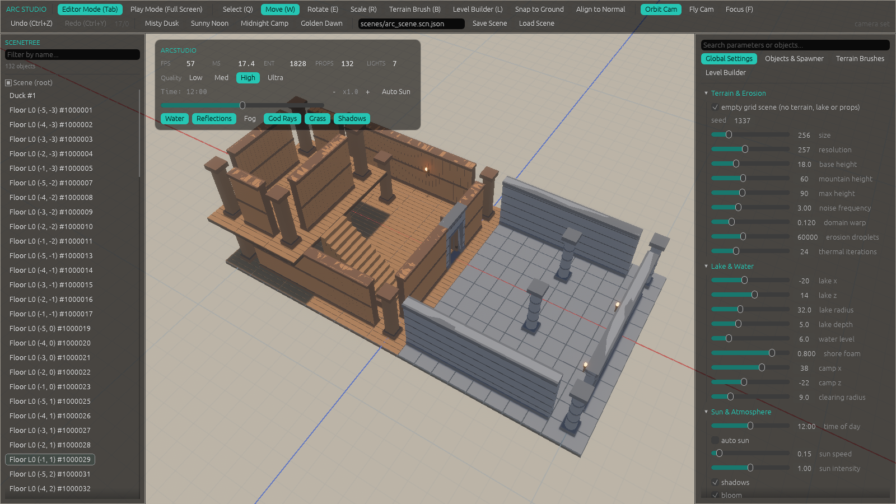
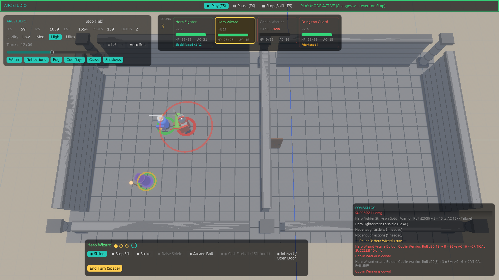
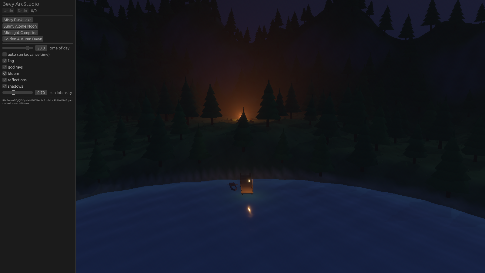
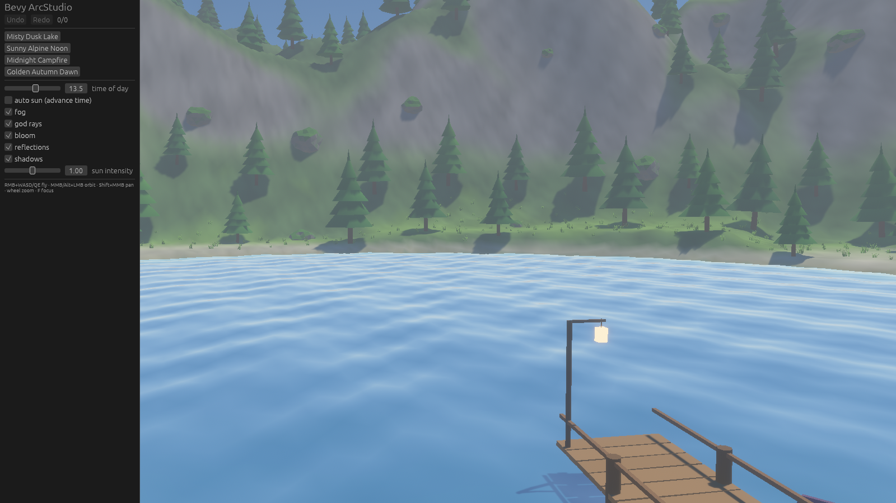
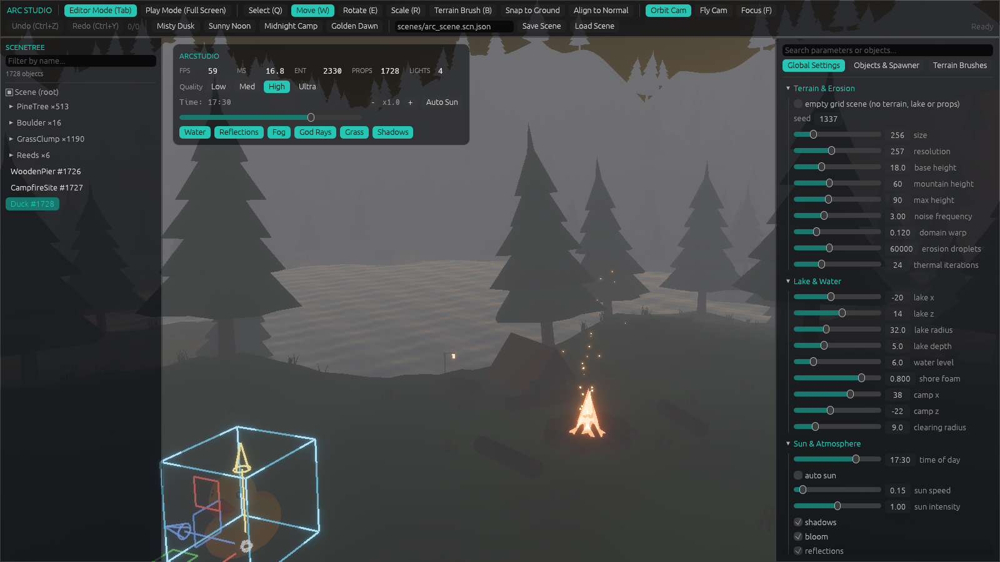

# Bevy ArcStudio

**AI-first procedural 3D environment studio & editor GUI for Bevy 0.20** · `MIT OR Apache-2.0`

English · [Русский](#русский)

Originally created to build levels for an upcoming RPG, it combines procedural terrain generation with manual scene editing and a remote command protocol (`bevy_remote`), so worlds can be built by hand or by AI agents (such as Claude).



| Level Builder | Tactical PF2e combat (Play mode) |
|---|---|
|  |  |

| Misty dusk lake | Sunny alpine noon |
|---|---|
|  |  |

## Features

- Procedural terrain: domain-warped noise, droplet hydraulic erosion, 5-layer splatmap, Poisson-disk prop scattering.
- Atmosphere, sun cycle, volumetric fog, water, bloom; 4 world presets and quality presets.
- Editor: Scenetree outliner (filter, rename, drag-and-drop reparent, grouped instances), 3D move/rotate/scale gizmo, picking, surface snapping, terrain brushes (6 kinds), universal Reflect inspector with *Add Component*, `.glb` import, "Empty Grid Scene" mode (no terrain/lake/props), reflect scene save/load (`.scn.json` + `.heights`, extensible via `register_scene_component::<T>()`), feet↔world `UnitScale`.
- **Modules tab**: a module whose `module.json` lies in `modules/<id>/` is found by the editor and therefore already connected; the tab only switches it on/off at runtime (state in `modules/state.json`), has *Rescan*, and *Add* copies a `module.json` or module folder from any path into `modules/`. For agents: `SetModule`, `RescanModules`, `ConnectModule`. Module code is compiled into the app (no dynamic library loading); a module file without matching code is listed as "no code in this build".
- Extensible `EditorRegistry`: tools (with hotkeys), panels and inspector tabs are registered by plugins (`WorldEnvironmentPlugin`, `LevelBuilderPlugin`, ...).
- Unified transactional undo/redo (world settings, objects, terrain strokes, reparenting, components).
- Level Builder (`L`): modular tiles on a snap grid (floor, wall, doorway with swinging door, arch, pillar, stairs, roof, torch with a point light), multiple floors, rooms drawn by drag; navigation is rebuilt on change.
- Asset Browser: `.glb`/`.gltf` models, prefabs (`.prefab.json`), scenes and the procedural/level kit, click to place.
- AI control: every action is a `StudioCommand` pushed through a reflected resource over `bevy_remote` (BRP), screenshots via `brp_extras/screenshot`. See [SKILL.md](SKILL.md).
- Play-in-Editor: `Play` / `Pause` / `Stop` in the toolbar. Play snapshots the whole scene (world settings, objects, tiles, doors, prefab instances, actors, editor camera, undo stacks); Stop restores it exactly, so nothing done while playing (moved characters, opened doors, spawned effects, changed HP) survives. Also available to agents as `StudioCommand::SetPlayMode { mode }`.
- Prefabs: tiles of a spawned prefab follow its root when it is moved or rotated.
- Pathfinding (Theta* + funnel) with click-to-move.
- Extension points for game plugins: `EditorRegistry` (tools, panels, inspector overrides, spawner items), `SpawnKinds` (spawn handlers by kind), `CustomCommands` (`StudioCommand::Custom { name, args }`), scene-component registry.
- **Pathfinder 2e plugin** (separate crate `crates/bevy_arc_pf2e`, built only on those extension points; the editor has no PF2e code): RON actor archetypes, factions, trigger volumes, and pilot tactical combat (distances in feet): initiative, 3-action turns, Stride / Step / Strike / Arcane Bolt / Fireball / Raise Shield / Interact, Reactive Strike gate that stops a Stride mid-route, enemy AI, Turn Order Bar, Tactical Hotbar and Combat Log. Agents drive it through the `CombatInput` order queue.
- Scripted snow-castle showcase: `cargo run --bin showcase`.
- Pure, unit-tested math core in `src/arc_core.rs`, independent of ECS rendering.

## Hotkeys

| Key | Action |
|---|---|
| `Q` / `W` / `E` / `R` | Select / Move / Rotate / Scale |
| `B` / `L` | Terrain Brush / Level Builder |
| `T` (Level Builder) | Rotate tile facing |
| `Space` / `Esc` (combat) | End turn / Cancel |
| `F` | Focus selected object |
| `Shift` (while dragging) | Surface Snap |
| `F5` / `F6` / `Shift+F5` | Play / Pause (resume) / Stop (rollback) |
| `Tab` | Toggle Editor Mode / Play Mode (Stop) |
| `Ctrl+Z` / `Ctrl+Y` | Undo / Redo |
| RMB + `WASD` | Fly mode |
| `Delete` | Delete selected |



## Quick start

```bash
./run.sh            # Windows: run.bat
./run.sh dusk       # presets: dusk | noon | night | dawn
```

Embed into your game (Bevy 0.20, `DefaultPlugins` first):

```rust
use bevy::prelude::*;
use bevy_arc_studio::prelude::*;

fn main() {
    App::new()
        .add_plugins(DefaultPlugins)
        .add_plugins(BevyArcStudioPlugin::default())
        .run();
}
```

The prelude exports `BevyArcStudioPlugin`, `WorldSpec`, `HeightfieldGrid`, `SceneObject`, `StudioCommandQueue`, `UndoHistory`.
The editor is game-agnostic. Pathfinder 2e lives in the optional `bevy_arc_pf2e` crate: `app.add_plugins(BevyArcStudioPlugin::default()).add_plugins(bevy_arc_pf2e::Pf2ePlugin)`. The stock app (`cargo run`, crate `arc_studio_app`) has the code built in; the module file `modules/pf2e/module.json` (with its `actors/*.ron`) switches it on.
Use `BevyArcStudioPlugin::with_spec(WorldSpec::from_preset(..))` to start from a preset.

## Clean-Room AI Engineering & Provenance Audit

The project was built by an AI agent from independent mathematical specifications, with every stage audited.

- Manifest with SHA-256 hashes of the specs: [CLEAN_ROOM_PROOF.md](docs/clean_room_audit/CLEAN_ROOM_PROOF.md)
- Math specifications: [01](docs/architecture/01_viewport_camera_math.md) · [02](docs/architecture/02_3d_gizmo_projection.md) · [03](docs/architecture/03_surface_snapping_and_picking.md) · [04](docs/architecture/04_procedural_terrain_and_splatmap.md) · [05](docs/architecture/05_transactional_undo_and_mcp_api.md)
- Stage prompts: [00](docs/clean_room_audit/prompts/stage_00_prompt.md) · [01](docs/clean_room_audit/prompts/stage_01_prompt.md) · [02](docs/clean_room_audit/prompts/stage_02_prompt.md) · [03](docs/clean_room_audit/prompts/stage_03_prompt.md) · [04](docs/clean_room_audit/prompts/stage_04_prompt.md) · [05](docs/clean_room_audit/prompts/stage_05_prompt.md) · … all stages up to E7: [docs/clean_room_audit/prompts/](docs/clean_room_audit/prompts/)
- Flight logs: [docs/clean_room_audit/logs/](docs/clean_room_audit/logs/)

## Project Status & Contributing

**Bevy ArcStudio** is being developed alongside my own upcoming RPG. My primary focus is building the game and evolving this editor to fit its needs, so I can't promise a strict release schedule or full-time support.

However, **forks, issues, and Pull Requests are very welcome!** I will gladly review and merge useful community contributions whenever time permits. Feel free to use this repository as a foundation for your own Bevy tools or games.

## License

Dual-licensed under [MIT](LICENSE-MIT) or [Apache-2.0](LICENSE-APACHE).

Duck.glb: Sony Computer Entertainment Inc. (CC-BY 4.0) via Khronos glTF Sample Assets.

---

## Русский

**ИИ-ориентированная студия процедурной 3D-среды и визуальный редактор для Bevy 0.20.**

Проект создавался как рабочий инструмент для уровней моей будущей RPG. Он сочетает процедурную генерацию и ручное редактирование сцены с протоколом `bevy_remote`, поэтому локации можно собирать и мышкой, и с помощью ИИ-агентов (например, Claude).


| Конструктор уровней | Тактический бой PF2e (Play) |
|---|---|
|  |  |

### Возможности

- Процедурный рельеф: domain warping, капельная гидравлическая эрозия, 5-слойный splatmap, Poisson-Disk рассадка объектов.
- Атмосфера, цикл солнца, объёмный туман, вода, bloom; 4 пресета мира и пресеты качества.
- Редактор: Scenetree (фильтр, переименование, drag-and-drop смена родителя, группы инстансов), 3D-гизмо (перенос/поворот/масштаб), пикинг, Surface Snap, 6 кистей рельефа, универсальный Reflect-инспектор с *Add Component*, импорт `.glb`, режим «Empty Grid Scene» (без рельефа/озера/пропсов), сохранение/загрузка сцены в JSON.
- **Вкладка Modules**: если файл модуля `modules/<id>/module.json` лежит в папке модулей, редактор его видит и модуль уже подключён; во вкладке его только включают/выключают на лету (состояние в `modules/state.json`). Есть *Rescan*, а *Add* копирует `module.json` или папку модуля с любого пути в `modules/`. Для агентов: `SetModule`, `RescanModules`, `ConnectModule`. Код модулей вкомпилирован в приложение (динамической загрузки библиотек нет); файл без соответствующего кода помечается «no code in this build».
- Расширяемый `EditorRegistry`: инструменты (с хоткеями), панели и вкладки инспектора регистрируются плагинами (`WorldEnvironmentPlugin`, `LevelBuilderPlugin`, ...).
- Единый транзакционный Undo/Redo (настройки мира, объекты, мазки рельефа, смена родителя, компоненты).
- Level Builder (`L`): модульные тайлы на сетке (пол, стена, проём с открывающейся дверью, арка, колонна, лестница, крыша, факел с точечным светом), несколько этажей, комнаты протягиваются мышью; навигация перестраивается автоматически.
- Asset Browser: модели `.glb`/`.gltf`, префабы (`.prefab.json`), сцены и процедурный набор/набор уровня, размещение по клику.
- Управление ИИ-агентами: команды `StudioCommand` через рефлектируемый ресурс по `bevy_remote` (BRP), скриншоты через `brp_extras/screenshot`. См. [SKILL.md](SKILL.md).
- Play-in-Editor: кнопки `Play` / `Pause` / `Stop` в тулбаре. Play делает снимок всей сцены (настройки мира, объекты, тайлы, двери, инстансы префабов, акторы, камера редактора, стеки undo); Stop восстанавливает её точь-в-точь: сдвинутые персонажи, открытые двери, эффекты и изменённое HP не сохраняются. Для агентов: `StudioCommand::SetPlayMode { mode }`.
- Префабы: тайлы заспавненного префаба следуют за его корнем при перемещении и повороте.
- Поиск пути (Theta* + funnel), click-to-move.
- Точки расширения для игровых плагинов: `EditorRegistry` (инструменты, панели, inspector overrides, пункты спавнера), `SpawnKinds` (обработчики спавна по `kind`), `CustomCommands` (`StudioCommand::Custom { name, args }`), реестр компонентов сцены.
- **Плагин Pathfinder 2e** (отдельный крейт `crates/bevy_arc_pf2e`, только через эти точки расширения; в редакторе кода PF2e нет): RON-архетипы акторов, фракции, триггер-объёмы и пилотный тактический бой (расстояния в футах): инициатива, 3 действия за ход, Stride / Step / Strike / Arcane Bolt / Fireball / Raise Shield / Interact, Reactive Strike прерывает Stride на маршруте, ИИ врагов, Turn Order Bar, Tactical Hotbar и Combat Log. Для агентов — очередь приказов `CombatInput`.
- Скриптовое шоукейс-демо «Снежный замок»: `cargo run --bin showcase`.
- Чистое математическое ядро `src/arc_core.rs` с юнит-тестами, без зависимости от ECS-рендера.

### Горячие клавиши

| Клавиша | Действие |
|---|---|
| `Q` / `W` / `E` / `R` | Выбор / Перенос / Поворот / Масштаб |
| `B` / `L` | Кисть рельефа / Level Builder |
| `T` (Level Builder) | Поворот тайла |
| `Space` / `Esc` (бой) | Конец хода / Отмена |
| `F` | Фокус на выбранном объекте |
| `Shift` (при перетаскивании) | Surface Snap |
| `F5` / `F6` / `Shift+F5` | Play / Pause (продолжить) / Stop (откат) |
| `Tab` | Режим редактора / Play (Stop) |
| `Ctrl+Z` / `Ctrl+Y` | Отмена / Повтор |
| ПКМ + `WASD` | Режим полёта (Fly) |
| `Delete` | Удалить выбранное |

### Быстрый старт

```bash
./run.sh            # Windows: run.bat
./run.sh noon       # пресеты: dusk | noon | night | dawn
```

Подключение к своей игре одной строкой (после `DefaultPlugins`; стандартное приложение `cargo run` уже содержит код PF2e; включает его файл `modules/pf2e/module.json`):

```rust
app.add_plugins(BevyArcStudioPlugin::default());
app.add_plugins(bevy_arc_pf2e::Pf2ePlugin); // опционально: модуль PF2e
```

### Clean-Room AI Engineering & Provenance Audit (аудит происхождения)

- Манифест со слепками SHA-256 спецификаций: [CLEAN_ROOM_PROOF.md](docs/clean_room_audit/CLEAN_ROOM_PROOF.md)
- Математические спецификации: [docs/architecture/01..05](docs/architecture/01_viewport_camera_math.md)
- Промпты этапов: [docs/clean_room_audit/prompts/](docs/clean_room_audit/prompts/) (этапы 00–11, E0–E7)
- Бортовые журналы: [docs/clean_room_audit/logs/](docs/clean_room_audit/logs/)

### Статус проекта и участие

В первую очередь я развиваю этот инструмент под задачи своей игры, поэтому уделяю репозиторию время по мере возможности. Тем не менее, я открыт к идеям сообщества: **форки и пулл-реквесты приветствуются**. Буду рад смотреть и вливать полезные доработки по мере свободного времени!

Лицензия: [MIT](LICENSE-MIT) или [Apache-2.0](LICENSE-APACHE).

## 💖 Support / Донаты
- 🇷🇺 **Из России (СБП / Карты):** [CloudTips](https://pay.cloudtips.ru/p/429760d6)
- 🌍 **International (USDT Polygon):** `0xF5A1a9C39626C99AB4A8e92c8c06ccF9F5109dd5`
