# Bevy ArcStudio

https://github.com/user-attachments/assets/350c3808-5fd0-472f-8c72-ffeb1465093c

[Full quality video (mp4)](docs/arcstudio_promo.mp4)


**AI-first procedural 3D environment studio & editor GUI for Bevy 0.20** · `MIT OR Apache-2.0`

English · [Русский](#русский)

Originally created to build levels for an upcoming RPG, it combines procedural terrain generation with manual scene editing and a remote command protocol (`bevy_remote`), so worlds can be built by hand or by AI agents (such as Claude).

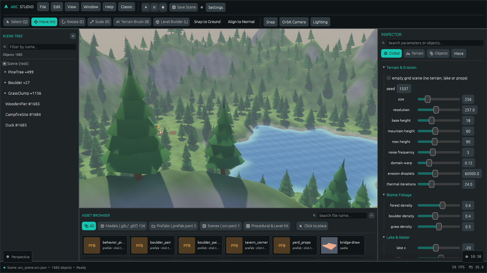

| Level Builder | Tactical PF2e combat (Play mode) |
|---|---|
| 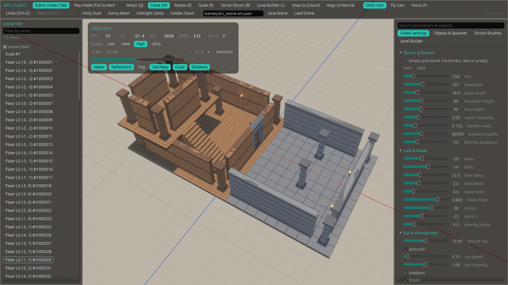 | 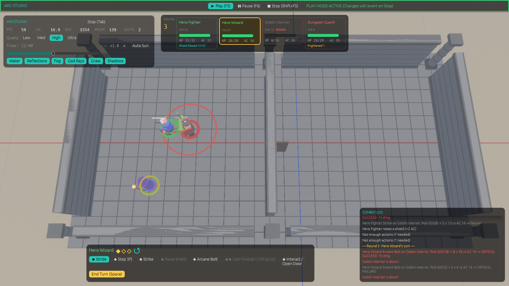 |

| Asset browser | Play-in-Editor (scene rollback) |
|---|---|
| 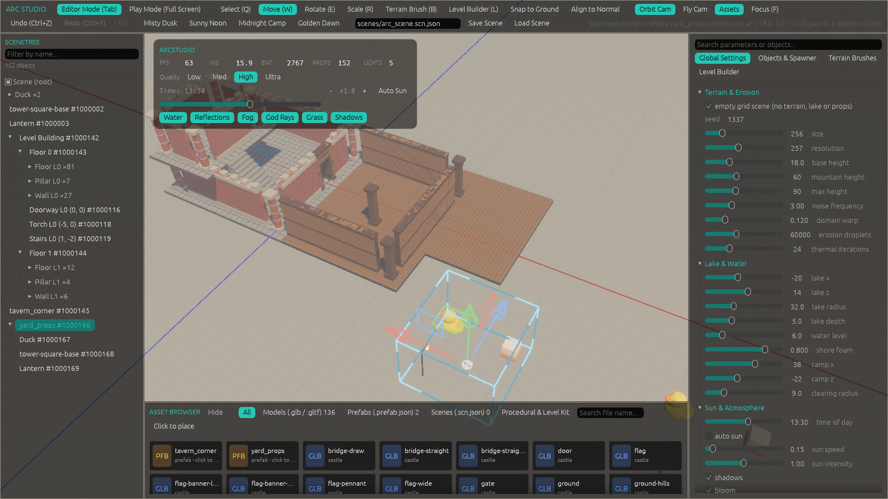 | 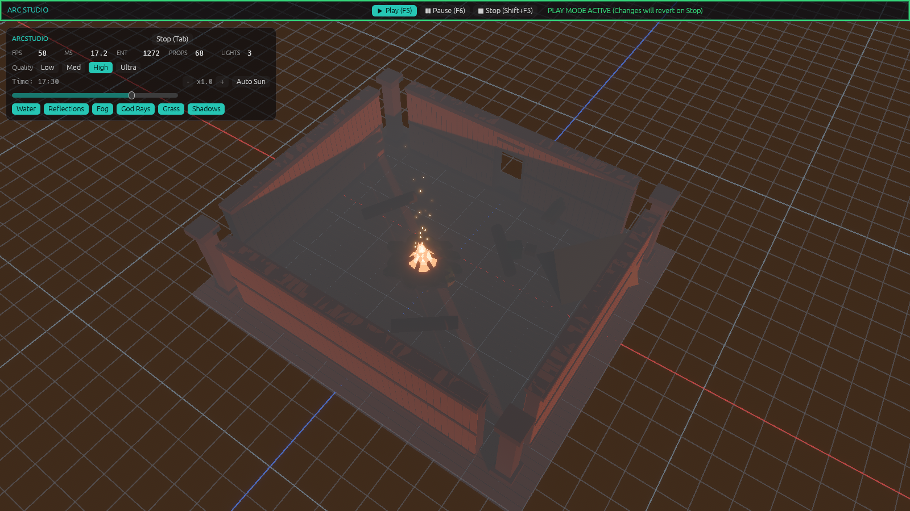 |

| Misty dusk lake | Sunny alpine noon |
|---|---|
| 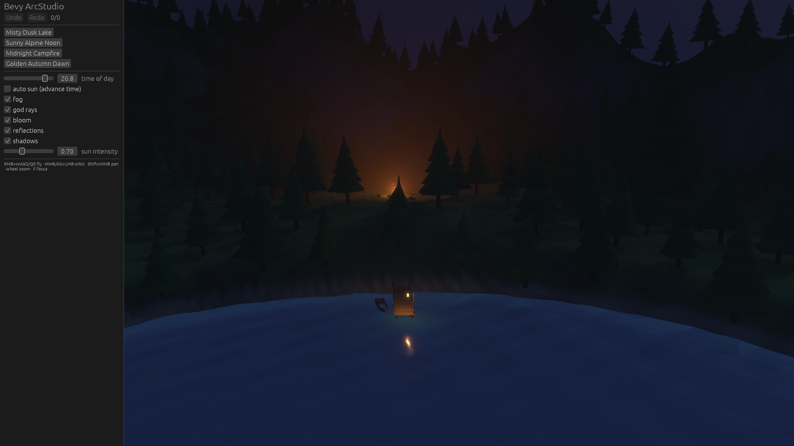 | 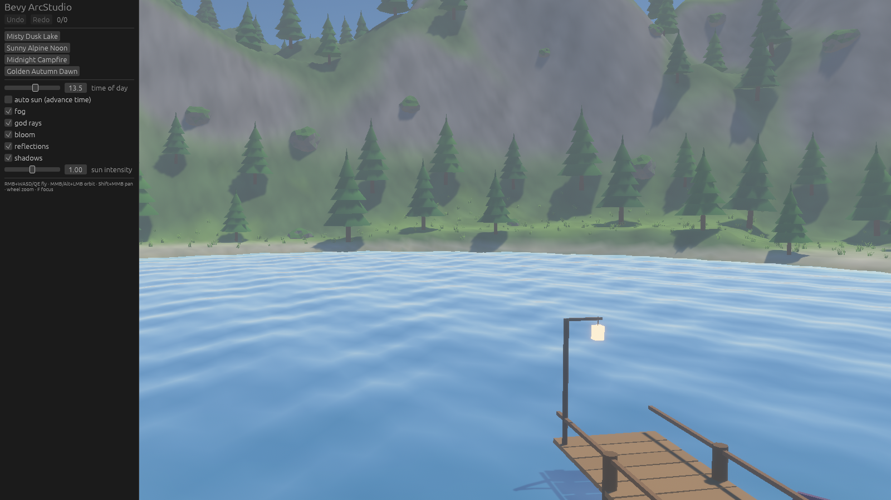 |

## Features

- Procedural terrain: domain-warped noise, droplet hydraulic erosion, 6-layer splatmap, Poisson-disk prop scattering.
- Atmosphere, sun cycle, volumetric fog, water, bloom; 4 world presets and quality presets.
- Editor: Scenetree outliner (filter, rename, drag-and-drop reparent, grouped instances), 3D move/rotate/scale gizmo, picking, surface snapping, terrain brushes (6 kinds), universal Reflect inspector with *Add Component*, `.glb` import, "Empty Grid Scene" mode (no terrain/lake/props), reflect scene save/load (`.scn.json` + `.heights`, extensible via `register_scene_component::<T>()`), feet↔world `UnitScale`.
- **Modules tab**: a module whose `module.json` lies in `modules/<id>/` is found by the editor and therefore already connected; the tab only switches it on/off at runtime (state in `modules/state.json`), has *Rescan*, and *Add* copies a `module.json` or module folder from any path into `modules/`. For agents: `SetModule`, `RescanModules`, `ConnectModule`. Module code is compiled into the app (no dynamic library loading); a module file without matching code is listed as "no code in this build".
- Extensible `EditorRegistry`: tools (with hotkeys), panels and inspector tabs are registered by plugins (`WorldEnvironmentPlugin`, `LevelBuilderPlugin`, ...).
- Unified transactional undo/redo (world settings, objects, terrain strokes, reparenting, components).
- Level Builder (`L`): modular tiles on a snap grid (floor, wall, doorway with swinging door, arch, pillar, stairs, roof, torch with a point light), multiple floors, rooms drawn by drag; navigation is rebuilt on change.
- Asset Browser: `.glb`/`.gltf` models, prefabs (`.prefab.json`), scenes and the procedural/level kit, click to place.
- AI control: every action is a `StudioCommand` pushed through a reflected resource over `bevy_remote` (BRP), screenshots via `brp_extras/screenshot`. Commands cover terrain, objects, camera, Level Builder, water, prefabs, modules and plugin commands; payloads in [SKILL.md](SKILL.md), live schema via `Describe`.
- Play-in-Editor: `Play` / `Pause` / `Stop` in the toolbar. Play snapshots the whole scene (world settings, objects, tiles, doors, prefab instances, actors, editor camera, undo stacks); Stop restores it exactly, so nothing done while playing (moved characters, opened doors, spawned effects, changed HP) survives. Also available to agents as `StudioCommand::SetPlayMode { mode }`.
- Separate game process: save a `.scn.json` scene, then use the **Separate game** window to Launch it. The editor uses BRP port 15702; the game uses 15704. The live entity tree refreshes automatically; components can be read and edited, and the game supports Pause / Resume / Stop. Stop leaves the editor scene unchanged. Use **Switch game to scene** to load another saved scene and resume Play. [Usage and BRP commands](docs/architecture/10_separate_game.md).
- Prefabs: tiles of a spawned prefab follow its root when it is moved or rotated.
- Water bodies: each basin can have its own water level (`SetWaterBody`), so a moat can be filled without raising the lake; levels are saved in scenes and navigation wades accordingly. Grass, pines, rocks and reeds follow the sculpted terrain, and grass and pines under water are hidden.
- **World simulation**: Noodle world graphs are executed, not just drawn — a typed, versioned pipeline (noise → hydraulic/thermal erosion → temperature → rain & water flow → biology → Poisson scatter) is evaluated on the CPU with deterministic, budget-guarded math. In Play mode a multiphysics grid (water, oil, lava, snow/ice, heat) conserves mass and energy; PF2e effects such as Fireball feed it, and terrain, water and navigation update live.
- Pathfinding (Theta* + funnel) with click-to-move.
- Extension points for game plugins: `EditorRegistry` (tools, panels, inspector overrides, spawner items), `SpawnKinds` (spawn handlers by kind), `CustomCommands` (`StudioCommand::Custom { name, args }`), scene-component registry.
- **Pathfinder 2e plugin** (separate crate `crates/bevy_arc_pf2e`, built only on those extension points; the editor has no PF2e code): RON actor archetypes, factions, trigger volumes, and pilot tactical combat (distances in feet): initiative, 3-action turns, Stride / Step / Strike / Arcane Bolt / Fireball / Raise Shield / Interact, Reactive Strike gate that stops a Stride mid-route, enemy AI, Turn Order Bar, Tactical Hotbar and Combat Log. Agents drive it through the `CombatInput` order queue.
- Scripted snow-castle showcase: `cargo run --bin showcase`.
- Pure, unit-tested math core in `src/arc_core.rs`, independent of ECS rendering.

## Quillshade and Noodle integration

The integration is complete through stage I2: materials, environment, executed world graphs and CPU multiphysics are part of the editor ([I2 acceptance log](docs/clean_room_audit/logs/stage_i2_acceptance_log.md)). The simulation backend is ArcStudio's own pure math core; upstream provides the material runtime and the node canvas.

- [bevy-quillshade](https://github.com/fe3dback/bevy-quillshade): generated material crate in `crates/quillshade`, WESL/assets, 11 generated 3D materials with typed `f32`/`Vec4` parameter overrides and a Reflect binding inspector. Bindings cover objects, tiles, prefab roots and individual linked-prefab members; terrain has a master material plus 6 splat-layer slots, and each water basin can carry its own material. Environment presets persist with transitions, Undo/Redo and PIE rollback; source RON hot-reloads. `file_watcher` is enabled; material layout or generated Rust changes require recompilation.
- [bevy_noodle](https://github.com/gold-silver-copper/bevy_noodle): native **Node Graph** canvas (drag/connect/delete, auto-layout), typed and versioned world and PF2e graph templates in RON, graph validation, shared Undo/Redo and Play-in-Editor rollback. World graphs run through the CPU evaluator (see *World simulation* above); event graphs drive PF2e effects.
- BRP commands: `AssignQuillshadeMaterial`, `SetTerrainMaterial`, `SetWaterMaterial`, `SetQuillshadeEnvironment`, `ReplaceStudioGraph`, `AddStudioGraphNode`, `SetStudioGraphParameters`, `EvaluateStudioGraph`, `SaveStudioGraph`, `LoadStudioGraph`, `AutoLayoutStudioGraph`, `SetGraphPanel`, `DescribeIntegration`. Query the live schema with `Describe`; `DescribeIntegration` reports material IDs, graph RON, terrain/water sections and supported capabilities.

See the [contracts and work plan](docs/architecture/08_quillshade_noodle.md) and the [integration verification log](docs/clean_room_audit/logs/stage_09_integration_log.md).

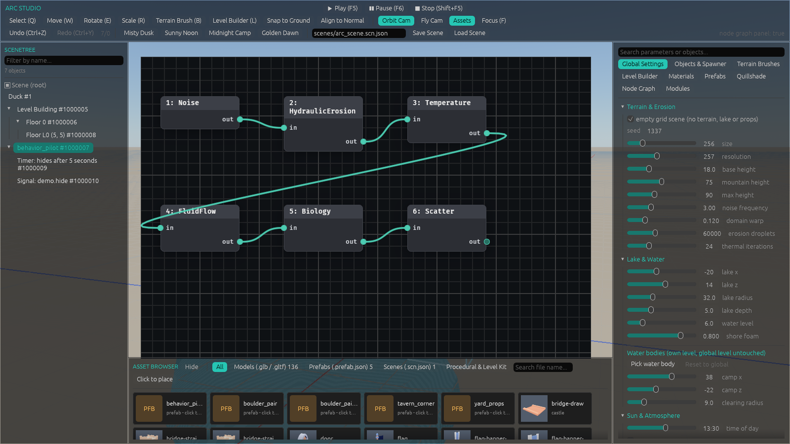

Upstream snapshots: Quillshade [`35be859`](https://github.com/fe3dback/bevy-quillshade/tree/35be8595ddf71d3fb4d354f8508e6460f1d340db), Noodle [`211f5df`](https://github.com/gold-silver-copper/bevy_noodle/tree/211f5df175755d9c73b1da9457f1802008f69951). Both declare MIT; imported files retain upstream headers and Noodle's LICENSE. See [provenance and licensing details](docs/architecture/third_party_integration.md). Noodle is the upstream library, not Quillshade's fork.

Regenerate with `./scripts/regenerate_quillshade.ps1 -ShaderEditor <path-to-shader_editor>` using the compatible upstream Quillshade executable. Edit source RON in `quillshade/`; generated output is one-way and must not be edited manually.

Verified on Windows: I2 acceptance closed all eight criteria on 2026-11-04 (BRP scenarios, multiphysics balances, Fireball/Theta* and viewed screenshots); the library suite on 2026-11-12 runs 174 tests passed, one doctest ignored. `.cargo/config.toml` keeps build output and temporary files in the workspace's `target/` directory (E: on the development machine). [Build memory recovery and rollback](docs/architecture/08_quillshade_noodle.md) are documented; pagefile changes are a separate administrative action, never part of a build.

## Interface layouts

Choose **View → Interface Layout** or press **Ctrl+Shift+1/2/3**. Classic keeps the scene tree, inspector and asset browser around the viewport. Focus puts tools in a vertical dock and opens panels on demand. Smart groups registered panels into Scene, Terrain, World, Build and Modules. Select a tool explicitly to start editing in that mode.

| Classic | Focus | Smart |
|---|---|---|
| 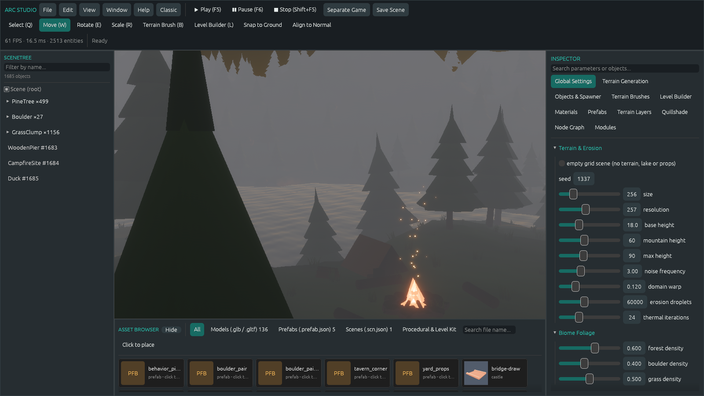 | 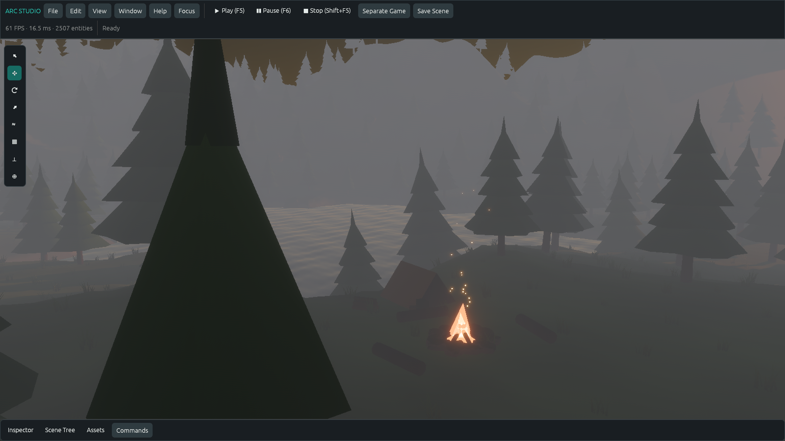 | 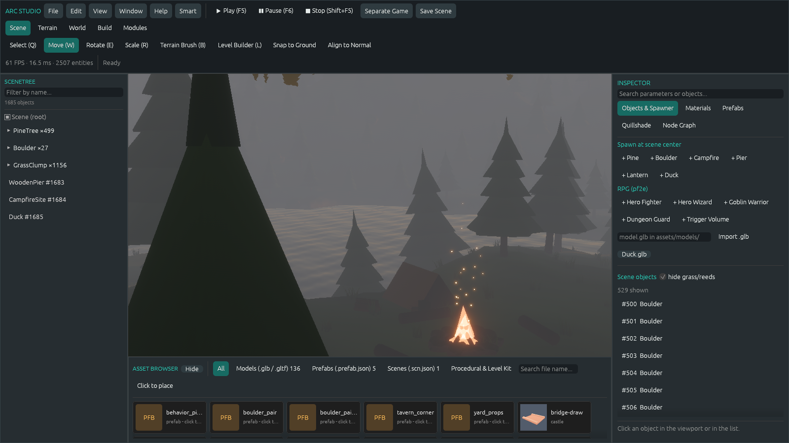 |

The interface is bilingual: **Settings → Language** switches English/Russian, and the choice persists in `ArcStudio/interface.json`.

Use **Window** to show and pin panels. Press **Ctrl+K** to search commands, panels and tools. Use the arrows to select an entry, Enter to run it and Esc to close the palette. **F** frames the selection. **Separate Game** sits beside the Play controls.

ArcStudio saves interface preferences to `ArcStudio/interface.json` in the user configuration directory. **View → Interface Layout** can reset the current profile or all profiles.

Use **File → Scene Path…** to edit the scene path, then choose **File → Save Scene** or **File → Load Scene**. The toolbar’s **Save Scene** button uses the same path.

Plugins register a stable panel ID and a shared renderer through `EditorRegistry` using `register_panel` or `register_panel_def`. Unclassified inspector panels appear in Smart → Modules. Panel renderers use the same command queue across layouts.

Register inspector panels at `PanelLocation::RightInspector` to make them available in the Classic inspector, the Focus Window menu, and the corresponding Smart workspace. For a contextual tool, bind its `ToolDef` to the same panel ID so Focus can open it when the tool is active. Module-owned entries disappear from navigation when the module is disabled. Reuse the same ID when re-enabling the module so a pinned inspector can restore its context.

## Hotkeys

| Key | Action |
|---|---|
| `Q` / `W` / `E` / `R` | Select / Move / Rotate / Scale |
| `B` / `L` | Terrain Brush / Level Builder |
| `T` (Level Builder) | Rotate tile facing |
| `Space` / `Esc` (combat) | End turn / Cancel |
| `F` | Focus selected object |
| `Shift` (while dragging) | Surface Snap |
| `F5` / `F6` / `Shift+F5` | Play / Pause (resume) / Stop (rollback) |
| `Tab` | Toggle Editor Mode / Play Mode (Stop) |
| `Ctrl+Z` / `Ctrl+Y` | Undo / Redo |
| RMB + `WASD` | Fly mode |
| `Delete` | Delete selected |

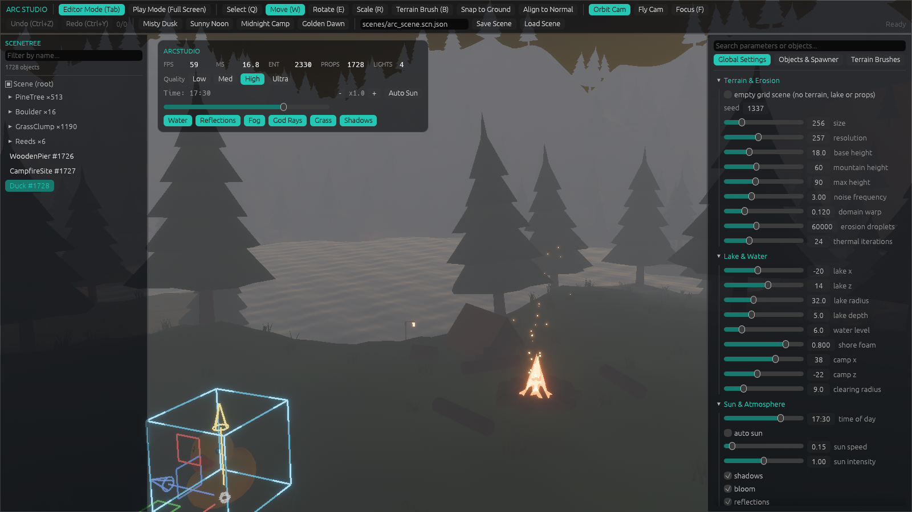

## Quick start

Prebuilt editor binaries for Windows, Linux and macOS are attached to the [v0.1.0 release](https://github.com/Zirich90/bevy_arc_studio/releases/tag/v0.1.0); each archive bundles the app with `assets/`, scenes, modules and Quillshade materials. Or build from source:

```bash
./run.sh            # Windows: run.bat
./run.sh dusk       # presets: dusk | noon | night | dawn
```

Embed into your game (Bevy 0.20, `DefaultPlugins` first):

```rust
use bevy::prelude::*;
use bevy_arc_studio::prelude::*;

fn main() {
    App::new()
        .add_plugins(DefaultPlugins)
        .add_plugins(BevyArcStudioPlugin::default())
        .run();
}
```

The prelude exports `BevyArcStudioPlugin`, `WorldSpec`, `HeightfieldGrid`, `SceneObject`, `StudioCommandQueue`, `UndoHistory`.
The editor is game-agnostic. Pathfinder 2e lives in the optional `bevy_arc_pf2e` crate: `app.add_plugins(BevyArcStudioPlugin::default()).add_plugins(bevy_arc_pf2e::Pf2ePlugin)`. The stock app (`cargo run`, crate `arc_studio_app`) has the code built in; the module file `modules/pf2e/module.json` (with its `actors/*.ron`) switches it on.
Use `BevyArcStudioPlugin::with_spec(WorldSpec::from_preset(..))` to start from a preset.

### Workspace layout

| Path | Contents |
|---|---|
| `bevy_arc_studio` (root, `src/`) | the editor library: terrain, level builder, navigation, scene I/O, BRP commands |
| `crates/arc_studio_app` | the stock binary (`cargo run`) with PF2e built in |
| `crates/bevy_arc_pf2e` | optional Pathfinder 2e crate (actors, tactical combat) behind editor extension points |
| `crates/quillshade`, `quillshade/`, `assets/quillshade/` | generated Quillshade runtime, source RON and shader/material assets |
| `vendor/bevy_noodle` | pinned upstream native node editor (MIT) |
| `modules/<id>/module.json` | module files found by the *Modules* tab; switched on/off at runtime |

## Clean-Room AI Engineering & Provenance Audit

The project was built by an AI agent from independent mathematical specifications, with every stage audited.

- Manifest with SHA-256 hashes of the specs: [CLEAN_ROOM_PROOF.md](docs/clean_room_audit/CLEAN_ROOM_PROOF.md)
- Math specifications: [01](docs/architecture/01_viewport_camera_math.md) · [02](docs/architecture/02_3d_gizmo_projection.md) · [03](docs/architecture/03_surface_snapping_and_picking.md) · [04](docs/architecture/04_procedural_terrain_and_splatmap.md) · [05](docs/architecture/05_transactional_undo_and_mcp_api.md)
- Stage prompts: [00](docs/clean_room_audit/prompts/stage_00_prompt.md) · [01](docs/clean_room_audit/prompts/stage_01_prompt.md) · [02](docs/clean_room_audit/prompts/stage_02_prompt.md) · [03](docs/clean_room_audit/prompts/stage_03_prompt.md) · [04](docs/clean_room_audit/prompts/stage_04_prompt.md) · [05](docs/clean_room_audit/prompts/stage_05_prompt.md) · … all stages: [docs/clean_room_audit/prompts/](docs/clean_room_audit/prompts/)
- Flight logs: [docs/clean_room_audit/logs/](docs/clean_room_audit/logs/)

## Project Status & Contributing

**Bevy ArcStudio** is being developed alongside my own upcoming RPG. My primary focus is building the game and evolving this editor to fit its needs, so I can't promise a strict release schedule or full-time support.

However, **forks, issues, and Pull Requests are very welcome!** I will gladly review and merge useful community contributions whenever time permits. Feel free to use this repository as a foundation for your own Bevy tools or games.

## License

Dual-licensed under [MIT](LICENSE-MIT) or [Apache-2.0](LICENSE-APACHE).

Bundled third-party code and assets retain their own licenses; see [integration provenance](docs/architecture/third_party_integration.md).

Duck.glb: Sony Computer Entertainment Inc. (CC-BY 4.0) via Khronos glTF Sample Assets.

---

## Русский

**ИИ-ориентированная студия процедурной 3D-среды и визуальный редактор для Bevy 0.20.**

Проект создавался как рабочий инструмент для уровней моей будущей RPG. Он сочетает процедурную генерацию и ручное редактирование сцены с протоколом `bevy_remote`, поэтому локации можно собирать и мышкой, и с помощью ИИ-агентов (например, Claude).

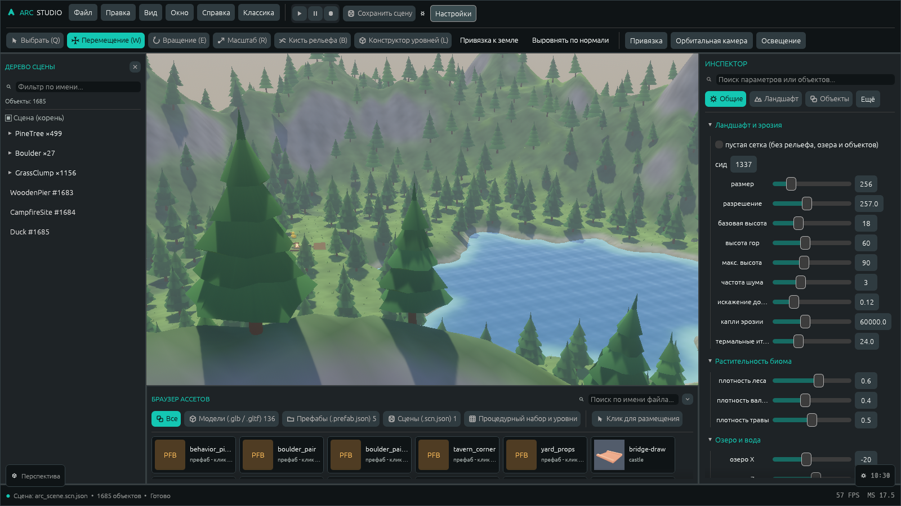

| Конструктор уровней | Тактический бой PF2e (Play) |
|---|---|
|  |  |

| Браузер ассетов | Play-in-Editor (откат сцены) |
|---|---|
|  |  |

### Возможности

- Процедурный рельеф: domain warping, капельная гидравлическая эрозия, 6-слойный splatmap, Poisson-Disk рассадка объектов.
- Атмосфера, цикл солнца, объёмный туман, вода, bloom; 4 пресета мира и пресеты качества.
- Редактор: Scenetree (фильтр, переименование, drag-and-drop смена родителя, группы инстансов), 3D-гизмо (перенос/поворот/масштаб), пикинг, Surface Snap, 6 кистей рельефа, универсальный Reflect-инспектор с *Add Component*, импорт `.glb`, режим «Empty Grid Scene» (без рельефа/озера/пропсов), сохранение/загрузка сцены в JSON.
- **Вкладка Modules**: если файл модуля `modules/<id>/module.json` лежит в папке модулей, редактор его видит и модуль уже подключён; во вкладке его только включают/выключают на лету (состояние в `modules/state.json`). Есть *Rescan*, а *Add* копирует `module.json` или папку модуля с любого пути в `modules/`. Для агентов: `SetModule`, `RescanModules`, `ConnectModule`. Код модулей вкомпилирован в приложение (динамической загрузки библиотек нет); файл без соответствующего кода помечается «no code in this build».
- Расширяемый `EditorRegistry`: инструменты (с хоткеями), панели и вкладки инспектора регистрируются плагинами (`WorldEnvironmentPlugin`, `LevelBuilderPlugin`, ...).
- Единый транзакционный Undo/Redo (настройки мира, объекты, мазки рельефа, смена родителя, компоненты).
- Level Builder (`L`): модульные тайлы на сетке (пол, стена, проём с открывающейся дверью, арка, колонна, лестница, крыша, факел с точечным светом), несколько этажей, комнаты протягиваются мышью; навигация перестраивается автоматически.
- Asset Browser: модели `.glb`/`.gltf`, префабы (`.prefab.json`), сцены и процедурный набор/набор уровня, размещение по клику.
- Управление ИИ-агентами: команды `StudioCommand` через рефлектируемый ресурс по `bevy_remote` (BRP), скриншоты через `brp_extras/screenshot`. Команды для рельефа, объектов, камеры, Level Builder, воды, префабов, модулей и плагинов; форматы в [SKILL.md](SKILL.md), актуальная схема через `Describe`.
- Play-in-Editor: кнопки `Play` / `Pause` / `Stop` в тулбаре. Play делает снимок всей сцены (настройки мира, объекты, тайлы, двери, инстансы префабов, акторы, камера редактора, стеки undo); Stop восстанавливает её точь-в-точь: сдвинутые персонажи, открытые двери, эффекты и изменённое HP не сохраняются. Для агентов: `StudioCommand::SetPlayMode { mode }`.
- Отдельный игровой процесс: сохраните сцену `.scn.json` и запустите её через **Separate game → Launch**. BRP редактора — порт 15702, игры — 15704. Дерево сущностей обновляется автоматически; доступны чтение и правка компонентов, Pause / Resume / Stop. Stop сохраняет редакторскую сцену без изменений. **Switch game to scene** загружает другую сохранённую сцену и продолжает Play. [Инструкция и команды BRP](docs/architecture/10_separate_game.md).
- Префабы: тайлы заспавненного префаба следуют за его корнем при перемещении и повороте.
- Водоёмы: у каждого бассейна свой уровень воды (`SetWaterBody`), поэтому ров можно залить, не поднимая озеро; уровни сохраняются в сцене, навигация учитывает брод. Трава, сосны, камни и тростник следуют за изменённым рельефом, трава и сосны под водой скрываются.
- **Симуляция мира**: графы Noodle исполняются, а не только рисуются — типизированный версионированный конвейер (шум → гидравлическая/термальная эрозия → температура → дождь и поток воды → биология → Poisson-рассадка) считается на CPU детерминированно, с защитой от неограниченных нагрузок. В Play мультифизическая сетка (вода, нефть, лава, снег/лёд, тепло) сохраняет массу и энергию; эффекты PF2e (например, Fireball) питают её, а рельеф, вода и навигация обновляются на лету.
- Поиск пути (Theta* + funnel), click-to-move.
- Точки расширения для игровых плагинов: `EditorRegistry` (инструменты, панели, inspector overrides, пункты спавнера), `SpawnKinds` (обработчики спавна по `kind`), `CustomCommands` (`StudioCommand::Custom { name, args }`), реестр компонентов сцены.
- **Плагин Pathfinder 2e** (отдельный крейт `crates/bevy_arc_pf2e`, только через эти точки расширения; в редакторе кода PF2e нет): RON-архетипы акторов, фракции, триггер-объёмы и пилотный тактический бой (расстояния в футах): инициатива, 3 действия за ход, Stride / Step / Strike / Arcane Bolt / Fireball / Raise Shield / Interact, Reactive Strike прерывает Stride на маршруте, ИИ врагов, Turn Order Bar, Tactical Hotbar и Combat Log. Для агентов — очередь приказов `CombatInput`.
- Скриптовое шоукейс-демо «Снежный замок»: `cargo run --bin showcase`.
- Чистое математическое ядро `src/arc_core.rs` с юнит-тестами, без зависимости от ECS-рендера.

### Интеграция Quillshade и Noodle

Интеграция завершена, этап I2 принят: материалы, окружение, исполняемые графы мира и CPU-мультифизика входят в редактор ([журнал приёмки I2](docs/clean_room_audit/logs/stage_i2_acceptance_log.md)). Backend симуляции — собственное чистое матядро ArcStudio; upstream даёт runtime материалов и нодовый канвас.

- [bevy-quillshade](https://github.com/fe3dback/bevy-quillshade): генерируемый крейт материалов `crates/quillshade`, WESL/ассеты, 11 3D-материалов с типизированными overrides `f32`/`Vec4` и Reflect-инспектором привязки. Привязки к объектам, тайлам, корням префабов и отдельным членам linked-префабов; у рельефа мастер-материал и 6 слоев splatmap, у каждого водоёма может быть свой материал. Пресеты окружения сохраняются вместе с переходами, Undo/Redo и откатом PIE; исходный RON перечитывается на лету.
- [bevy_noodle](https://github.com/gold-silver-copper/bevy_noodle): нативный **Node Graph** (drag/connect/delete, авто-раскладка), типизированные версионированные шаблоны мира и PF2e в RON, валидация, общий Undo/Redo и откат PIE. Графы мира исполняются CPU-оценатором (см. «Симуляция мира» выше); графы событий управляют эффектами PF2e.
- Команды BRP: `AssignQuillshadeMaterial`, `SetTerrainMaterial`, `SetWaterMaterial`, `SetQuillshadeEnvironment`, `ReplaceStudioGraph`, `AddStudioGraphNode`, `SetStudioGraphParameters`, `EvaluateStudioGraph`, `SaveStudioGraph`, `LoadStudioGraph`, `AutoLayoutStudioGraph`, `SetGraphPanel`, `DescribeIntegration`; актуальные форматы через `Describe`.

Кодогенерация односторонняя: исходники в `quillshade/`, запуск через `scripts/regenerate_quillshade.ps1`; generated Rust/WESL вручную не менять.

[Контракты и план](docs/architecture/08_quillshade_noodle.md) · [журнал приёмки I2](docs/clean_room_audit/logs/stage_i2_acceptance_log.md) · [исходные коммиты и лицензии MIT](docs/architecture/third_party_integration.md). Проверено на Windows: приёмка I2 закрыла все восемь критериев 2026-11-04 (BRP-сценарии, балансы мультифизики, Fireball/Theta* и просмотренные снимки); библиотечные тесты на 2026-11-12 — 174 passed, один doctest пропущен. Сборки и временные файлы находятся в `target/` на диске workspace; на рабочей машине это E:.

### Интерфейс и раскладки

**View → Interface Layout** или **Ctrl+Shift+1/2/3**: Classic (дерево сцены, инспектор и браузер ассетов вокруг вьюпорта), Focus (вертикальный док инструментов, панели по запросу), Smart (контекстные workspace: Scene, Terrain, World, Build, Modules). Палитра команд — **Ctrl+K**, **F** — фокус на выбранном. Интерфейс двуязычный: **Settings → Language** переключает English/Русский, выбор сохраняется в `ArcStudio/interface.json`.

### Горячие клавиши

| Клавиша | Действие |
|---|---|
| `Q` / `W` / `E` / `R` | Выбор / Перенос / Поворот / Масштаб |
| `B` / `L` | Кисть рельефа / Level Builder |
| `T` (Level Builder) | Поворот тайла |
| `Space` / `Esc` (бой) | Конец хода / Отмена |
| `F` | Фокус на выбранном объекте |
| `Shift` (при перетаскивании) | Surface Snap |
| `F5` / `F6` / `Shift+F5` | Play / Pause (продолжить) / Stop (откат) |
| `Tab` | Режим редактора / Play (Stop) |
| `Ctrl+Z` / `Ctrl+Y` | Отмена / Повтор |
| ПКМ + `WASD` | Режим полёта (Fly) |
| `Delete` | Удалить выбранное |

### Быстрый старт

Готовые бинарники редактора для Windows, Linux и macOS прикреплены к [релизу v0.1.0](https://github.com/Zirich90/bevy_arc_studio/releases/tag/v0.1.0); в архиве приложение вместе с `assets/`, сценами, модулями и материалами Quillshade. Или сборка из исходников:

```bash
./run.sh            # Windows: run.bat
./run.sh noon       # пресеты: dusk | noon | night | dawn
```

Подключение к своей игре одной строкой (после `DefaultPlugins`; стандартное приложение `cargo run` уже содержит код PF2e; включает его файл `modules/pf2e/module.json`):

```rust
app.add_plugins(BevyArcStudioPlugin::default());
app.add_plugins(bevy_arc_pf2e::Pf2ePlugin); // опционально: модуль PF2e
```

### Структура workspace

| Путь | Содержимое |
|---|---|
| `bevy_arc_studio` (корень, `src/`) | библиотека редактора: рельеф, конструктор уровней, навигация, ввод-вывод сцены, команды BRP |
| `crates/arc_studio_app` | стандартное приложение (`cargo run`) со встроенным PF2e |
| `crates/bevy_arc_pf2e` | необязательный крейт Pathfinder 2e (актёры, тактический бой) через точки расширения редактора |
| `modules/<id>/module.json` | файлы модулей, которые видит вкладка *Modules*; включаются/выключаются на лету |

### Clean-Room AI Engineering & Provenance Audit (аудит происхождения)

- Манифест со слепками SHA-256 спецификаций: [CLEAN_ROOM_PROOF.md](docs/clean_room_audit/CLEAN_ROOM_PROOF.md)
- Математические спецификации: [docs/architecture/01..05](docs/architecture/01_viewport_camera_math.md)
- Промпты этапов: [docs/clean_room_audit/prompts/](docs/clean_room_audit/prompts/) (этапы 00–12, E0–E9)
- Бортовые журналы: [docs/clean_room_audit/logs/](docs/clean_room_audit/logs/)

### Статус проекта и участие

В первую очередь я развиваю этот инструмент под задачи своей игры, поэтому уделяю репозиторию время по мере возможности. Тем не менее, я открыт к идеям сообщества: **форки и пулл-реквесты приветствуются**. Буду рад смотреть и вливать полезные доработки по мере свободного времени!

Лицензия: [MIT](LICENSE-MIT) или [Apache-2.0](LICENSE-APACHE).

## 💖 Support / Донаты
- 🇷🇺 **Из России (СБП / Карты):** [CloudTips](https://pay.cloudtips.ru/p/429760d6)
- 🌍 **International (USDT Polygon):** `0xF5A1a9C39626C99AB4A8e92c8c06ccF9F5109dd5`
