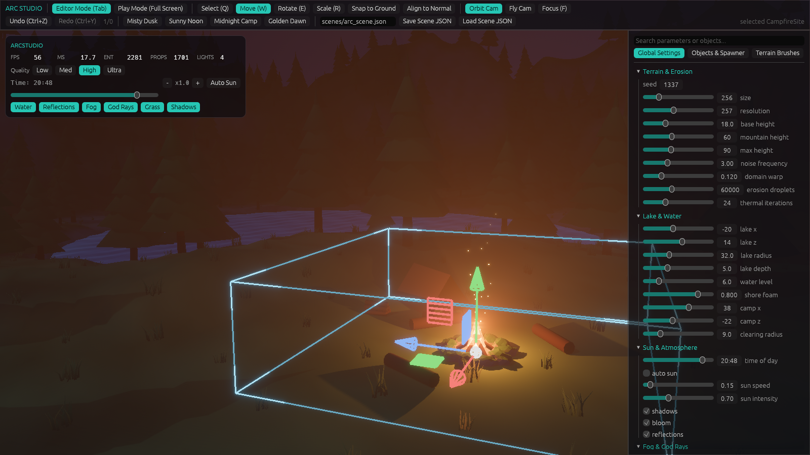
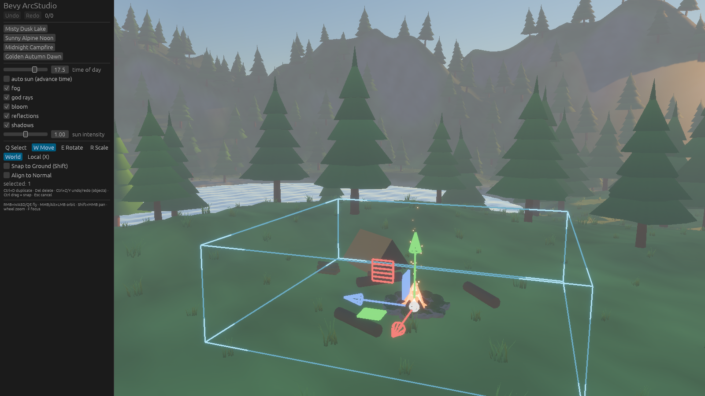

# Bevy ArcStudio

**AI-first procedural 3D environment studio & editor GUI for Bevy 0.20** · `MIT OR Apache-2.0`

English · [Русский](#русский)



| Misty dusk lake | Sunny alpine noon |
|---|---|
|  |  |

## Features

- Procedural terrain: domain-warped noise, droplet hydraulic erosion, 5-layer splatmap, Poisson-disk prop scattering.
- Atmosphere, sun cycle, volumetric fog, water, bloom; 4 world presets and quality presets.
- Editor: 3D move/rotate/scale gizmo, picking, surface snapping, terrain brushes (6 kinds), inspector, `.glb` import, reflect scene save/load (`.scn.json` + `.heights`, extensible via `register_scene_component::<T>()`), feet↔world `UnitScale`.
- Unified transactional undo/redo (world settings, objects, terrain strokes).
- AI control: every action is a `StudioCommand` pushed through a reflected resource over `bevy_remote` (BRP), screenshots via `brp_extras/screenshot`. See [SKILL.md](SKILL.md).
- Pure, unit-tested math core in `src/arc_core.rs`, independent of ECS rendering.

## Hotkeys

| Key | Action |
|---|---|
| `Q` / `W` / `E` / `R` | Select / Move / Rotate / Scale |
| `F` | Focus selected object |
| `Shift` (while dragging) | Surface Snap |
| `Tab` | Toggle Play / Editor |
| `Ctrl+Z` / `Ctrl+Y` | Undo / Redo |
| RMB + `WASD` | Fly mode |
| `Delete` | Delete selected |



## Quick start

```bash
./run.sh            # Windows: run.bat
./run.sh dusk       # presets: dusk | noon | night | dawn
```

Embed into your game (Bevy 0.20, `DefaultPlugins` first):

```rust
use bevy::prelude::*;
use bevy_arc_studio::prelude::*;

fn main() {
    App::new()
        .add_plugins(DefaultPlugins)
        .add_plugins(BevyArcStudioPlugin::default())
        .run();
}
```

The prelude exports `BevyArcStudioPlugin`, `WorldSpec`, `HeightfieldGrid`, `SceneObject`, `StudioCommandQueue`, `UndoHistory`.
Use `BevyArcStudioPlugin::with_spec(WorldSpec::from_preset(..))` to start from a preset.

## Clean-Room AI Engineering & Provenance Audit

The project was built by an AI agent from independent mathematical specifications, with every stage audited.

- Manifest with SHA-256 hashes of the specs: [CLEAN_ROOM_PROOF.md](docs/clean_room_audit/CLEAN_ROOM_PROOF.md)
- Math specifications: [01](docs/architecture/01_viewport_camera_math.md) · [02](docs/architecture/02_3d_gizmo_projection.md) · [03](docs/architecture/03_surface_snapping_and_picking.md) · [04](docs/architecture/04_procedural_terrain_and_splatmap.md) · [05](docs/architecture/05_transactional_undo_and_mcp_api.md)
- Stage prompts: [00](docs/clean_room_audit/prompts/stage_00_prompt.md) · [01](docs/clean_room_audit/prompts/stage_01_prompt.md) · [02](docs/clean_room_audit/prompts/stage_02_prompt.md) · [03](docs/clean_room_audit/prompts/stage_03_prompt.md) · [04](docs/clean_room_audit/prompts/stage_04_prompt.md) · [05](docs/clean_room_audit/prompts/stage_05_prompt.md)
- Flight logs: [docs/clean_room_audit/logs/](docs/clean_room_audit/logs/)

## Project Status & Maintenance (As-Is Disclaimer)

> **Important:** This project is provided **"AS IS"** under the MIT / Apache-2.0 licenses.
>
> It was developed as a clean-room AI-engineered foundation and is now gifted to the open-source community. Due to primary engineering workload, the author **does not actively maintain** this repository, provide user support, or commit to roadmap features (author participation will be rare, occasional, and mostly detached).
>
> **Forks, community maintenance, and pull requests are warmly encouraged!** Feel free to fork and build upon this foundation.

## License

Dual-licensed under [MIT](LICENSE-MIT) or [Apache-2.0](LICENSE-APACHE).

Duck.glb: Sony Computer Entertainment Inc. (CC-BY 4.0) via Khronos glTF Sample Assets.

---

## Русский

**ИИ-ориентированная студия процедурной 3D-среды и визуальный редактор для Bevy 0.20.**


### Возможности

- Процедурный рельеф: domain warping, капельная гидравлическая эрозия, 5-слойный splatmap, Poisson-Disk рассадка объектов.
- Атмосфера, цикл солнца, объёмный туман, вода, bloom; 4 пресета мира и пресеты качества.
- Редактор: 3D-гизмо (перенос/поворот/масштаб), пикинг, Surface Snap, 6 кистей рельефа, инспектор, импорт `.glb`, сохранение/загрузка сцены в JSON.
- Единый транзакционный Undo/Redo (настройки мира, объекты, мазки рельефа).
- Управление ИИ-агентами: команды `StudioCommand` через рефлектируемый ресурс по `bevy_remote` (BRP), скриншоты через `brp_extras/screenshot`. См. [SKILL.md](SKILL.md).
- Чистое математическое ядро `src/arc_core.rs` с юнит-тестами, без зависимости от ECS-рендера.

### Горячие клавиши

| Клавиша | Действие |
|---|---|
| `Q` / `W` / `E` / `R` | Выбор / Перенос / Поворот / Масштаб |
| `F` | Фокус на выбранном объекте |
| `Shift` (при перетаскивании) | Surface Snap |
| `Tab` | Play / Editor |
| `Ctrl+Z` / `Ctrl+Y` | Отмена / Повтор |
| ПКМ + `WASD` | Режим полёта (Fly) |
| `Delete` | Удалить выбранное |

### Быстрый старт

```bash
./run.sh            # Windows: run.bat
./run.sh noon       # пресеты: dusk | noon | night | dawn
```

Подключение к своей игре одной строкой (после `DefaultPlugins`):

```rust
app.add_plugins(BevyArcStudioPlugin::default());
```

### Clean-Room AI Engineering & Provenance Audit (аудит происхождения)

- Манифест со слепками SHA-256 спецификаций: [CLEAN_ROOM_PROOF.md](docs/clean_room_audit/CLEAN_ROOM_PROOF.md)
- Математические спецификации: [docs/architecture/01..05](docs/architecture/01_viewport_camera_math.md)
- Промпты этапов: [stage_00..05_prompt.md](docs/clean_room_audit/prompts/stage_05_prompt.md)
- Бортовые журналы: [docs/clean_room_audit/logs/](docs/clean_room_audit/logs/)

### Статус проекта: «Как есть» (As-Is) и сообщество

> **Важно:** Проект передаётся сообществу **«КАК ЕСТЬ» (AS IS)** под лицензиями MIT / Apache-2.0.
>
> Я отдаю этот рабочий фундамент в руки опенсорса как законченный продукт. Из-за плотной загрузки на основной работе я **не планирую активно поддерживать репозиторий**, решать проблемы совместимости по запросам или вести регулярную разработку (моё участие будет крайне редким и отдалённым).
>
> **Форки, пулл-реквесты и развитие проекта силами комьюнити только приветствуются!** Смело забирайте проект к себе и развивайте его дальше.

Лицензия: [MIT](LICENSE-MIT) или [Apache-2.0](LICENSE-APACHE).

## 💖 Support / Донаты
- 🇷🇺 **Из России (СБП / Карты):** [CloudTips](https://pay.cloudtips.ru/p/429760d6)
- 🌍 **International (USDT Polygon):** `0xF5A1a9C39626C99AB4A8e92c8c06ccF9F5109dd5`
