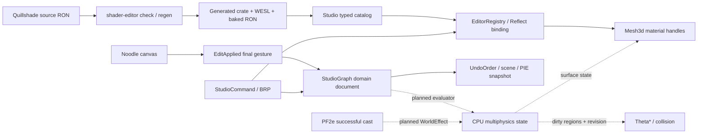

# ArcStudio: Quillshade и Noodle

Дата: 2026-11-02. Статус: интеграционный каркас, не приёмка мультифизического runtime.

## Проверенные источники

Obsidian: `AI Memori/bevy_quillshade/{00_INDEX,02_DECISIONS,Graph}`, `bevy_noodle/{00_INDEX,02_DECISIONS,Graph}`.
Quillshade commit `35be8595ddf71d3fb4d354f8508e6460f1d340db`, Noodle upstream commit `211f5df175755d9c73b1da9457f1802008f69951`.
Прочитаны исходники локальных клонов, включая generated sample_game. Граф ArcStudio — кэш от 2026-11-01; новые модули отсутствуют.
Исходный `EditorRegistry`: SHA256 `936963ec01fd306de104ecb6a910ddec6d4d65de14269da03db1645da90cb17e`.
Исходный `StudioCommand`: SHA256 `7f2ac7bb1f41d50cd41de3f742c14a3a9a123387e63740f3af85e545c0c38000`.
Исходный `arc_core.rs`: SHA256 `148c9a70638ed1c2629b62bd3d747cfc47c79a742defe1bde6d66cb708225b78`.
Эти хеши фиксируют исходную точку, не актуальность изменённых файлов.

## Границы владения



1. Quillshade standalone владеет `quillshade/**/*.ron`. Односторонняя генерация создаёт `crates/quillshade` и `assets/quillshade`.
2. ArcStudio зависит только от generated runtime. Rust/WESL/baked.ron не редактируются вручную.
3. `scripts/quillshade_catalog.py` после `shader-editor regen <studio-root>` создаёт отдельный `src/quillshade_catalog.rs`.
4. `EditorRegistry.quillshade_materials` хранит типизированные операции назначения/снятия для каждого generated 3D Material.
5. `QuillshadeBinding.material` хранит стабильный domain-relative id, не GPU handle. Это Reflect-компонент сцены/префаба.
6. Noodle upstream vendored отдельно. Редактор Quillshade и его fork Noodle в приложение не встраиваются.
7. `StudioGraph` в `arc_core.rs` — источник истины для graph domain. ECS canvas — перестраиваемое представление.
8. Мультифизика владеет CPU-полями и fixed-step evaluator; shader WPO не меняет коллизию, террейн и навигацию.

## Что реализовано

- Generated runtime и исходники/ассеты sample_game импортированы без ручных правок из указанного MIT upstream.
- Workspace membership, path dependency, Bevy `file_watcher`, watcher в исполняемом приложении.
- Загрузка BakedMaterials; каталог всех generated 3D материалов, включая PBR и unlit; Sprite2d сознательно исключён из Mesh3d dispatch.
- AssignQuillshadeMaterial через BRP/UI, Reflect-инспектор binding, история компонентов, scene/prefab serialization и PIE для объектов.
- Назначение распространяется на дочерние meshes; дочерний binding имеет приоритет. Снятие возвращает исходный StandardMaterial.
- Переключение generated light preset через UI/BRP; штатная система времени суток перестаёт перезаписывать light values.
- Native Noodle panel, два шаблона графов, drag/connect/disconnect/delete через настоящий edit pipeline.
- On<ConnectionCheck>: проверка домена, направления, ёмкости входа и DAG; On<EditApplied>: запись финального состояния в ComponentHistory.
- Graph edits используют существующий UndoOrder. Промежуточный drag не пишет историю; replay не создаёт новую транзакцию.
- Graph resource включён в сцены и snapshot PIE, транзиентные UI entities туда не входят.
- I2.02: typed numeric overrides f32/Vec4, layout guards, отдельные material handles и rebasing Hot Reload без потери overrides; linked-member edits записываются в PrefabOverrides.
- Canvas без фонового прямоугольника и сетки, масштаб нод 80%, компактные шаблоны слева под HUD; HUD и панель отдельной игры не скрываются при открытии графа.

## Контракты данных

### Quillshade

`*.material.ron`, `*.environment.ron`, `project.ron` сохраняют upstream schema. Их source of truth — Quillshade.
`baked.ron` и WESL — generated asset data. Значения hot reload допускаются только в прежнем SG_LAYOUT; новая структура требует regen/catalog/check/restart.
Reflect-инспектор студии редактирует типизированные numeric overrides generated uniforms. `QuillshadeBinding` хранит `material`, `layout` и список `parameters` (`Float`/`Vector`); padding, неизвестные имена, неподходящие типы и non-finite значения отклоняются. Структура материала по-прежнему меняется через исходный Quillshade, regen/catalog/check/restart.

BRP-проверка 2026-11-02: 11 материалов, assign/Undo/Redo, graph Undo/Redo, PIE rollback и scene roundtrip корня linked-префаба + level tile PASS. Прямой binding на дочернем элементе linked-префаба не сохраняется сценой: члены пересоздаются из prefab source. Назначать корню для наследования; сохранение индивидуального material override члена требует отдельного контракта PrefabOverrides. Rust: 142 теста PASS, один doctest ignored. Для снимков истории StudioGraph и QuillshadeBinding явно зарегистрирован Reflect Clone.
Обновление I2.02 от 2026-11-03: ограничение прямого member binding устранено маршрутизацией assign/parameters/Reflect/remove через persistent PrefabOverrides корня. BRP подтвердил Undo/Redo, remove, scene roundtrip и Stop PIE индивидуального member override; изменение базового RON обновило независимые instances с сохранением override. Историческая проверка выше описывает состояние каркаса до I2.02.
Не обещать runtime-изменение структуры Rust без пересборки.

```json
{"AssignQuillshadeMaterial":{"target":{"Name":"PineTree"},"material":"env/rock_wet"}}
{"SetQuillshadeEnvironment":{"preset":"night"}}
{"RemoveComponent":{"target":{"Name":"PineTree"},"component":"QuillshadeBinding"}}
{"SetGraphPanel":{"open":true}}
{"ReplaceStudioGraph":{"ron":"(version:1,nodes:[],edges:[])"}}
```

Команды идут через StudioCommandQueue, результаты — CommandResults. Для визуальной проверки использовать `brp_extras/screenshot`.
Assign и Replace undoable. I2.04: environment intent хранится в reflected resource (preset, duration, elapsed, from-values JSON), сохраняется в сцене и PIE, операции записываются в ресурсный Undo. I2.04 принят: BRP Undo/Redo/PIE/scene resume/Pause/managed-light release PASS; camera ownership восстановлен. Переход линейный, app-owned sampler использует публичный EnvironmentValues::interpolate и LightRuntime::apply_manifest_data; generated output не меняется. Скриншоты day/night/restored просмотрены.

### Граф

```ron
(
    version: 1,
    nodes: [
        (id: 1, kind: Noise, position: (40.0, 80.0), value: 1.0),
        (id: 2, kind: HydraulicErosion, position: (250.0, 80.0), value: 60000.0),
    ],
    edges: [(from: 1, to: 2)],
)
```

Stable node ids `u32`; позиции в graph units. Один вход/выход domain state либо world effect; выход допускает fan-out.
Лимит 512 nodes / 1024 edges; версия 1; finite numeric values; DAG; source nodes без входа.
`value` — поле совместимости v1; схема v2 использует типизированный enum `NodeParameters`. Импорт v1 выполняется через `StudioGraph::migrate` перед Replace/scene load: frequency/ambient/droplets/density/growth сохраняют основные величины, нормализованные legacy effect values масштабируются к параметрам по умолчанию. Пример выше — legacy import; новые templates записывают version 2 и params. I2.05 принят. CPU evaluator применяет Noise, эрозию, температуру, потоки, Biology и Scatter к сцене. BRP проверил миграцию v1, совпадение с mesh и объектами, Undo/Redo, PIE и сохранение. См. [аудит I2.05](../clean_room_audit/logs/stage_i2_05_log.md).
Фиксированный шаг мультифизики в работе. Статический расчёт графа и runtime физики имеют отдельные проверки.

### Целевой runtime contract (следующие этапы)

- WorldPipeline: Noise → HydraulicErosion → Temperature → FluidFlow → Biology → Scatter.
- WorldState: grid id/revision; heights m; temperature K; water/lava/oil mass kg и velocity m/s; snow/ice kg; biomass kg/m².
  В CPU-модели снег и лёд составляют общую твёрдую фазу воды. Её масса вычисляется из запаса воды и энтальпии ячейки. MeltSnow меняет локальную удельную теплоту плавления, сохраняя массу и энергию. Температура внутри backend хранится в °C, эквивалент в K получается прибавлением 273,15. Запас биомассы хранится в кг на ячейку, плотность получается делением на её площадь.
- EffectPipeline: Fireball → IgniteOil / MeltSnow / Granular → InvalidateNavigation. Для параллельных реакций использовать fan-out, не считать последовательность обязательной.
- WorldEffect: event id + session id + simulation tick + source id + position metres + radius metres + energy joules.
- PF2e публикует эффект только после успешного, не прерванного каста. Игровые feet переводятся через UnitScale; формула энергии — отдельное продуктовое решение.
- Точная точка адаптера PF2e: `crates/bevy_arc_pf2e/src/encounter.rs::act_fireball`, после `provoke` и успешного расхода действий. Сейчас функция возвращает `Ok(())` и при disrupted cast; публиковать эффект только по `Result::is_ok()` нельзя. Нужен явный outcome/message из успешной ветви. Студия не должна зависеть обратно от PF2e: общий контракт эффекта принадлежит runtime integration API.
- Evaluator: детерминированный fixed timestep, seed, topological order; эффекты idempotent по event id; Paused/Edit не тикают.
- Изменения высот/проходимости возвращают dirty AABB и revision. Theta* cache инвалидируется после commit геометрии, не из шейдера.
- Graph transaction хранит before/after документа и данных, которые evaluator применяет в Edit. Частичный результат при ошибке не публикуется.
- PIE snapshot должен включать simulation state, event cursor и revisions. Runtime эфемерные эффекты сбрасываются на Stop.

## План продолжения и критерии

### Следующий этап I2: исполнение графов и мультифизика

По решению владельца от 2026-11-02 публикуется проверенный интеграционный каркас. Незавершённые пункты ниже перенесены в I2; они не блокируют публикацию каркаса и не считаются реализованными.

Проверены полные исходники авторов и remote HEAD: Quillshade `35be8595ddf71d3fb4d354f8508e6460f1d340db`, Noodle `211f5df175755d9c73b1da9457f1802008f69951` (совпадают с импортированными снимками). Поиск `Biology`, `Granular`, `FluidFlow`, hydraulic/erosion, Fireball, avalanche, multiphysics, MeltSnow и IgniteOil в Rust/TOML/Markdown/RON/WESL не нашёл готового runtime этих систем.

- [Quillshade README](https://github.com/fe3dback/bevy-quillshade/blob/35be8595ddf71d3fb4d354f8508e6460f1d340db/README.md) и workspace описывают внешний редактор ассетов, шейдеров и освещения. `temperature` в `light_domain` относится к цветокоррекции; `BlackBody` вычисляет цвет, не перенос тепла.
- [Noodle README: evaluation](https://github.com/gold-silver-copper/bevy_noodle/tree/211f5df175755d9c73b1da9457f1802008f69951#evaluating-a-graph-is-your-apps-job) оставляет выполнение графа приложению. [geometry_nodes.rs](https://github.com/gold-silver-copper/bevy_noodle/blob/211f5df175755d9c73b1da9457f1802008f69951/examples/geometry_nodes.rs) содержит `Grid`, `Trees`, `Wave`, `Near`, `Instance` и функции `points`/`instance`: полезный образец обработки точек и инстансинга, без гидродинамики, горения, снега, лавин и Biology.

Объём I2: найти/реализовать отдельный CPU backend и typed node parameters; подключить Noise/эрозию, тепло и фазовые переходы, жидкости, Biology/Scatter и Granular; публиковать PF2e WorldEffect только после успешного каста; обновлять collision/Theta* по dirty regions и revision. Дополнительно завершить material parameter inspector, слоты слоёв/водоёмов, linked-member overrides, сохранение/Undo/PIE окружения и UX/визуальную/hot-reload приёмку.

Критерий I2: воспроизводимые физические сценарии, тесты детерминизма и сохранения/отката, проверенный путь Theta* до/после изменения, BRP-команды и просмотренные скриншоты. Имена нод и демонстрационный `geometry_nodes` не заменяют эти проверки.

### Последовательность реализации I2

1. Принять подключение: cargo check/test, BRP assign/remove/undo/redo, native drag/connect, screenshot обоих panel modes.
2. Material parameters: типизированные отражённые overrides generated uniforms; отдельный instance handle, отсутствие изменения чужих объектов, guards layout. Реализовано в I2.02: `QuillshadeBinding.layout/parameters`, numeric f32/Vec4, private handles, rebasing после baked Hot Reload; linked-member edits сохраняются в PrefabOverrides. BRP-проверка: `scripts/verify_material_parameters_brp.ps1 -HotReload`; подготовка upstream backend: `scripts/prepare_quillshade_regen.ps1 -UpstreamRoot <clone>`. Generated output не правится вручную.
3. Surface bindings: отдельные terrain master / splat layers / basin / tile / prefab slots. Текущий `SPLAT_LAYERS=6` (sand, gravel, grass, moss, rock, snow), несмотря на пять слоёв в исходном описании. Вода принята отдельно в I2.03: draw sections по владельцу бассейна, persistent global/per-basin binding, параметры, Undo/Redo, scene/PIE (`scripts/verify_water_materials_brp.ps1`, `stage_i2_03_water_log.md`). Terrain master + шесть layer sections приняты через `scripts/verify_terrain_materials_brp.ps1 -HotReload`: каждый слой получает собственный generated material instance; нормализованные веса задают неперекрывающиеся интервалы stochastic coverage. Studio-адаптер изменяет только загруженный WESL в памяти, generated-файлы остаются исходными. Проверены нулевой и ненулевой веса, независимость параметров, source Hot Reload, Undo/Redo и scene/PIE; скриншоты и ограничения в `stage_i2_03_terrain_log.md`. WPO сохраняет GPU-семантику исходного shader, collision принадлежит CPU terrain.
4. Environment ownership — принят I2.04: persisted preset/duration/elapsed/from-values, Undo/Redo, PIE и scene resume; возврат camera/IBL/skybox/global/light components, managed lights удаляются. 104 library tests и BRP PASS, три screenshot просмотрены.
5. World evaluator: сначала существующие HeightfieldGrid::generate/erode_hydraulic + Poisson scatter; затем температурные/фазовые/потоковые модели с тестами баланса массы/энергии.
6. PF2e evaluator: успешный Fireball публикует WorldEffect; масло горит, снег тает, Granular меняет высоты; каждое действие имеет воспроизводимый тест.
7. Навигация: dirty-region update, фактический Theta* путь до/после изменения; отсутствие тика при Pause; Stop восстанавливает все поля и историю.
8. Graph UX: typed parameter inspector, add-node menu, save/load standalone RON, общий gesture transaction для auto-layout; сейчас доступны templates и ReplaceStudioGraph.

Этапы 2–8 не считать выполненными наличием названий нод. Полная интеграция принимается только с физическими сценариями и просмотренными BRP screenshots.

## Ограничения исходного проекта

В Cargo.toml уже используется `bevy_brp_extras=0.23.0` с пояснением совместимости с Bevy 0.20; версию в этой работе не меняли.
Obsidian-папка студии на диске называется `ArcStudio`, а не `bevy_arc_studio`; существующую память не дублировать.
MIT provenance: `docs/architecture/third_party_integration.md`. Generated output остаётся воспроизводимым через upstream CLI и сохранённые RON-источники.

## Проверки и продолжение приёмки

Требование владельца: сборки только на E:. `.cargo/config.toml` задаёт workspace `target` и принудительные `TEMP/TMP=target/tmp` относительно корня проекта; здесь это `E:/bevy_arc_studio/target`. Каталог временных файлов создан. `cargo metadata` подтвердил target на E:.

`cargo check --tests --message-format=short -q -j 1` PASS; Python catalog tests 2 PASS; PowerShell BRP-сценарий синтаксически проверен.
Первоначально Windows исчерпывала commit memory: mmap 1455 в `target/integration_metadata.log`. E0463 `bevy_internal` был вызван невозможностью отобразить зависимости. Из 46.7 ГиБ commit limit оставалось около 1.4 ГиБ. Подкачка располагалась только на C: (14.8 ГиБ), при 10 ГиБ свободного места; E: имел 145 ГиБ свободного места.

2026-11-02 по запросу владельца исправлено: `scripts/configure_build_pagefile.ps1 -Action Apply` через Windows PowerShell/UAC добавил E:/pagefile.sys 32768–65536 MiB, сохранив системно управляемую подкачку C:. Файл E: активировался сразу; readback подтвердил увеличение commit limit примерно на 32 ГиБ без перезагрузки. Резервная копия исходных настроек: `target/pagefile-backup.json`, результат: `target/pagefile-result.json`.

Основание: [Microsoft: commit limit и рост системной подкачки](https://learn.microsoft.com/en-us/troubleshoot/windows-client/performance/introduction-to-the-page-file), [Win32_PageFileSetting: привилегии и отложенное применение настроек](https://learn.microsoft.com/en-us/windows/win32/cimwin32prov/win32-pagefilesetting). Не предполагать live-применение на любой Windows: скрипт проверяет активный файл и вычисляет `restartRequired` по readback; здесь E: активировался немедленно.

Проверка/откат (Windows PowerShell; Restore требует администратора и последующей перезагрузки для удаления активного E: pagefile):

```powershell
powershell.exe -NoProfile -File ./scripts/configure_build_pagefile.ps1 -Action Inspect
# В административной консоли при необходимости отката:
powershell.exe -NoProfile -File ./scripts/configure_build_pagefile.ps1 -Action Restore
```

Временный PBR opt-level=0 привёл к превышению лимита экспортов Windows DLL (124374 > 65535); это не рабочая конфигурация. Проверять исходные профили Cargo без снижения оптимизации:

```powershell
cargo test --message-format=short -q -j 1
cargo run --message-format=short -q -j 1 -p arc_studio_app --bin bevy_arc_studio
# В другой консоли, после готовности BRP:
./scripts/verify_integration_brp.ps1 -Port 15702
```

Затем открыть Quillshade/Node Graph, проверить drag/connect/delete с Undo/Redo, оба шаблона, preset и material render. Снять `brp_extras/screenshot` в `docs/screenshots/`, просмотреть PNG и только после этого записать verdict каркаса. Полная задача дополнительно требует этапов 2–8 выше.
